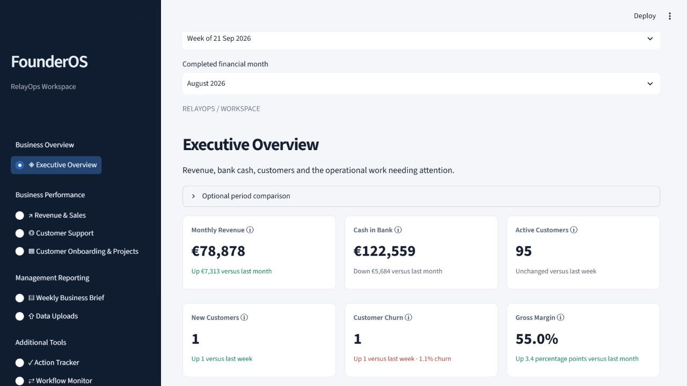
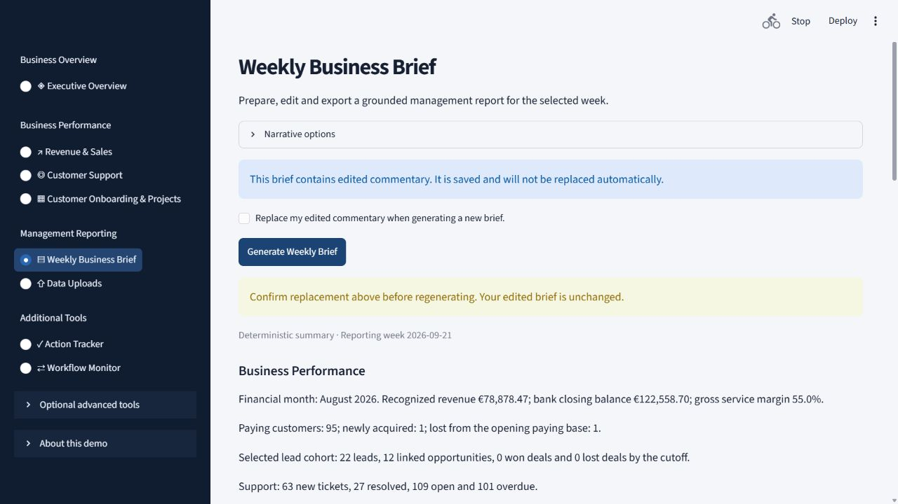

# FounderOS

### Business problem
Departmental files make it difficult to assemble a consistent weekly view of business performance, operational issues, and follow-ups.

### What it does
A Python/Streamlit reporting workspace for the fictional RelayOps startup. It validates Excel records, calculates revenue, sales, support, and onboarding indicators, and prepares an editable weekly management brief. Confirmed imports retain revision history; actions have an owner, deadline, and status.

### Main workflow
Download templates → upload raw departmental records → validate and preview → confirm import → compare performance → generate and edit a weekly brief → track follow-ups. Briefs export as PDF, printable HTML, or Markdown. Stale reports must be regenerated before export.

### Technologies
Python, Streamlit, Pandas, NumPy, Plotly, SQLite, OpenPyXL, JSON Schema, and ReportLab. Default commentary is deterministic. Optional local Ollama or hosted commentary is validated against evidence and falls back to a labelled deterministic report.

## Run locally

Use Python 3.12 or newer. From this repository's root:

```bash
python -m venv .venv
# macOS / Linux
source .venv/bin/activate
# Windows PowerShell: use .\.venv\Scripts\Activate.ps1 instead
python -m pip install -r requirements.txt
python -m streamlit run app.py
```

Open the local URL printed by Streamlit. If PowerShell activation is restricted, invoke `.venv\Scripts\python.exe` directly for the pip and streamlit commands. No model or API key is required for the default demonstration. Dependencies include the existing test tooling; installing them does not run tests.

### Demonstration data
The canonical CSVs in `data/` contain synthetic historical records for RelayOps. Templates and example import workbooks are included in `templates/`, `demo_reports/`, and `final_demo_reports/`. The working databases are created from those records; prior local imports, edited briefs, and action history are not published. See [business assumptions](docs/business_assumptions.md) and [metric definitions](docs/kpi_definitions.md).

### Application preview
Actual application captures using synthetic demonstration data:




### Limitations
Portfolio prototype, not a complete accounting system or a commercially deployed product. Missing evidence is shown as unavailable; related customer records do not prove causation. Optional AI output needs review. The included n8n workflow definitions are optional; live n8n deployment is not claimed verified. [n8n setup notes](docs/n8n_setup.md) describe configuration. PDF export uses Windows Arial when present and its existing built-in font fallback elsewhere; non-Windows visual parity has not been tested.

## Publication and hosting

Local databases, custom uploads, reviewer workspaces, secrets, caches, logs, review archives, and development outputs are excluded from Git. A fresh checkout starts from synthetic demonstration records and recreates its own SQLite state. Existing local state is retained on disk.

The Streamlit application needs a Python server and writable local storage; GitHub Pages cannot run it. Hosted SQLite files may be ephemeral, and this prototype has no production authentication or durable hosted storage configuration. Local Ollama requires a separately configured service and installed model; no model is bundled. Example environment variables are documentation only and are not automatically loaded from `.env.example`.
